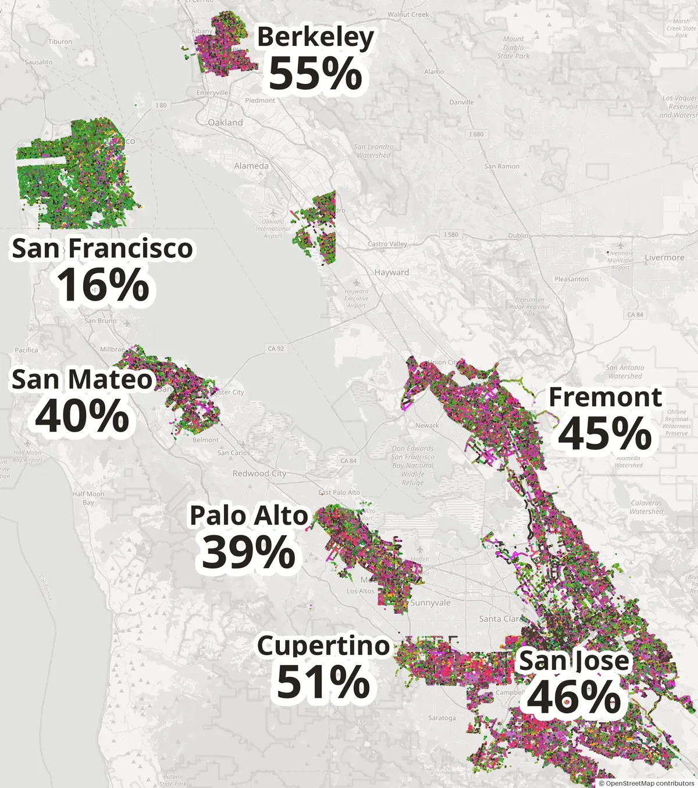

# TreeColors

**Every street tree in 47 North American cities, on one map — coloured by what it does in autumn.**

By [BotaniSense](https://botanisense.app/) · live at **https://treecolors.botanisense.app/**

[](https://treecolors.botanisense.app/)

Click any dot for its species, a botanical illustration, Wikipedia photos and a
link back to the city's own inventory record. Free, no account, runs entirely in
the browser.

## Why

Most "where to see fall colours" guides send people to the hills. In California
the hills are mostly evergreen; the colour people photograph is planted street
trees — pistache, sweetgum, maple, ginkgo. Saying that precisely requires
knowing which trees grow where. Cities publish that: their street-tree
inventories list every tree they maintain, with a species and a coordinate.

So we collect those inventories, name the species, and paint each tree by its
autumn behaviour. The same data answers other questions — how much of a city's
canopy is evergreen, what was planted where, which streets will be worth a walk
in three weeks — without a second collection effort.

It is not a botanical authority and not a forecast: species traits are
AI-assisted annotations, and the map shows what was planted, not what a given
tree will do this year.

## What is in it

- **7.0 million trees** in **47 cities** across the US and Canada, from the
  cities' own open inventories. Sunnyvale arrived as a spreadsheet by public
  records request, so it is the first city read from a workbook rather than a
  REST service.
- **1,912 species keys** (from 3,524 spellings in the inventories), resolved to
  a canonical name and traits: deciduous or evergreen, autumn colour, flowers,
  blooming season, common names in English and Chinese.
- **298 botanical plates** and 315 leaf thumbnails, covering 94% of mapped trees.
- **One PMTiles vector tileset** (~82 MB) with a single layer. There is no
  per-city selector: the map is the index, and the same file is served from a
  static host with HTTP Range.

### Colours

| Colour | Meaning |
|---|---|
| Green | Evergreen: keeps its leaves all winter |
| Orange | Ginkgo, in one literal orange |
| Red → purple | Deciduous, announces autumn colour |
| Brown → near-black | Deciduous, but nothing showy |

A species has **one colour in every city**: the colour is a hash of the
binomial inside the category's hue band, so spelling, case and cultivar never
paint the same tree two ways. Categories come from the knowledge base, not from
how a particular inventory labelled the tree.

### Cities

<!-- cities:start -->
<!-- Generated by scripts/readme_cities.py from web/species_stats.json. Do not edit by hand. -->

**47 cities · 7,035,464 trees · 66% turn in autumn.** Counts are from the last `web-assets` run.

| City | Trees | Turn | Added via | Slug |
|---|---:|---:|---|---|
| New York City, NY | 651,750 | 76% | registry | `new_york_ny` |
| Toronto, ON | 617,107 | 73% | registry | `toronto_on` |
| Calgary, AB | 564,293 | 67% | registry | `calgary_ab` |
| Edmonton, AB | 482,157 | 72% | registry | `edmonton_ab` |
| Mississauga, ON | 412,952 | 71% | registry | `mississauga_on` |
| Montreal, QC | 329,672 | 76% | registry | `montreal_qc` |
| Los Angeles, CA | 323,510 | 27% | legacy import | `los_angeles` |
| Winnipeg, MB | 305,551 | 88% | registry | `winnipeg_mb` |
| Denver, CO | 301,168 | 73% | registry | `denver_co` |
| Ottawa, ON | 286,622 | 70% | registry | `ottawa_on` |
| Hamilton, ON | 279,603 | 73% | registry | `hamilton_on` |
| Portland, OR | 216,101 | 84% | registry | `portland_or` |
| Seattle, WA | 214,549 | 69% | registry | `seattle_wa` |
| San Jose, CA | 204,593 | 46% | legacy import | `san_jose` |
| Washington, DC | 201,461 | 80% | registry | `washington_dc` |
| Philadelphia, PA | 149,942 | 68% | registry | `philadelphia_pa` |
| Vancouver, BC | 149,371 | 79% | legacy import | `vancouver` |
| Baltimore City, MD | 112,927 | 79% | registry | `baltimore_md` |
| Montgomery County, MD | 105,808 | 78% | registry | `montgomery_md` |
| Sacramento, CA | 105,153 | 47% | registry | `sacramento_ca` |
| San Francisco, CA | 95,051 | 16% | legacy import | `sf` |
| Riverside, CA | 93,572 | 21% | registry | `riverside_ca` |
| Fremont, CA | 78,216 | 45% | legacy import | `fremontca` |
| Richmond, VA | 76,529 | 82% | registry | `richmond_va` |
| Concord, CA | 75,611 | 41% | legacy import | `concordca` |
| Austin, TX | 58,667 | 33% | registry | `austin_tx` |
| Pasadena, CA | 55,138 | 13% | registry | `pasadena_ca` |
| Boston, MA | 52,006 | 85% | registry | `boston_ma` |
| Escondido, CA | 49,384 | 16% | registry | `escondido_ca` |
| Redlands, CA | 41,988 | 30% | registry | `redlands_ca` |
| Oakland, CA | 35,781 | 49% | registry | `oakland_ca` |
| Sunnyvale, CA | 32,903 | 43% | registry | `sunnyvale_ca` |
| Berkeley, CA | 30,316 | 55% | legacy import | `berkeley` |
| Palo Alto, CA | 30,258 | 39% | legacy import | `palo_alto` |
| Arlington County, VA | 29,298 | 81% | registry | `arlington_va` |
| Mountain View, CA | 28,518 | 46% | registry | `mountain_view_ca` |
| San Mateo, CA | 22,950 | 40% | registry | `san_mateo_ca` |
| San Diego, CA | 21,434 | 16% | legacy import | `sdtt` |
| Milpitas, CA | 17,240 | 49% | registry | `milpitas_ca` |
| Encinitas, CA | 16,706 | 8% | registry | `encinitas_ca` |
| Cupertino, CA | 16,521 | 51% | legacy import | `cupertino` |
| Burlingame, CA | 16,433 | 39% | registry | `burlingame_ca` |
| San Leandro, CA | 14,229 | 30% | legacy import | `sanleandroca` |
| Los Gatos, CA | 11,993 | 45% | registry | `los_gatos_ca` |
| Santa Clara, CA | 11,366 | 62% | registry | `santa_clara_ca` |
| Brisbane, CA | 4,650 | 7% | registry | `brisbane_ca` |
| Santa Clara County, CA | 4,416 | 36% | registry | `santa_clara_county_ca` |

<!-- cities:end -->

## Contributing

Two things the project needs most:

1. **More cities.** If your city publishes a tree inventory with coordinates
   and species, an adapter is usually a data-only change — no frontend or tiling
   code.
2. **Better species knowledge.** Traits, common names, aliases and explanations
   live in one JSON file and are easy to correct.

Smaller but welcome: name-normalisation cases seen in new inventories, map and
accessibility fixes, translations, documentation, tests, and anything that makes
the science firmer — for example deriving peak timing from climate, or
validating the colour categories against municipal phenology records.

Everything follows [`CONTRIBUTING.md`](CONTRIBUTING.md). The short version:

### Add your city

1. Confirm the publisher allows redistribution. The inventory must be public and
   its licence must permit publishing a derived map with attribution. Record the
   licence in [`DATA_LICENSES.md`](DATA_LICENSES.md) — if that is unclear, open an
   issue first and we will check together.
2. Add a `CitySpec` with its `SourceSpec`s to
   [`py/tree_pipeline/cities.py`](py/tree_pipeline/cities.py). Copy the nearest
   existing city: ArcGIS REST, Socrata, CSV and local `.xlsx` (`kind="workbook"`,
   for data a city sends by records request) sources are supported, and the
   fields to map are the species name, coordinates, an id and an address if the
   inventory has one.
3. Run it and read the QA report:

   ```bash
   cd py
   python -m tree_pipeline list
   python -m tree_pipeline fetch   --city your_city
   python -m tree_pipeline process --city your_city
   cat ../data/output/qa/your_city.json   # kept, deduped, invalid, missing species
   ```

4. If species names did not resolve, add them to the knowledge base — by hand
   in `data/tree_info/species_info.json`, or with `python -m tree_pipeline enrich
   --city your_city --dry-run` first to list what is missing (`OPENAI_API_KEY`
   needed to fill it automatically).
5. Rebuild and look at it:

   ```bash
   python -m tree_pipeline all --city your_city
   cd .. && ./build_tiles.sh
   scripts/serve_local.sh 8768
   tests/ui/check_ui.py --url http://127.0.0.1:8768/
   ```

6. Open a pull request with the adapter, the `DATA_LICENSES.md` row, and the
   QA numbers (kept trees, share that turns). We re-run the pipeline on the full
   dataset and add the city to the live map.

The city table in this README is generated from `web/species_stats.json`; after a
data change run `python3 scripts/readme_cities.py` (CI checks that it is current).

### Correct the species data

- `data/tree_info/species_info.json` — one entry per canonical key (`"acer
  rubrum"`), with `deciduous`, `fall_colors`, `beautiful_flowers`,
  `blooming_season`, `common_names`, `chinese_common_names` and a one-sentence
  `explanation`. Genus-level entries use `"Genus spp."`.
- `data/tree_info/species_aliases.json` — inventory spellings and common names →
  canonical key. This is how "Crepe Myrtle" and "Lagerstroemia indica" become
  one tree.
- Add or merge keys with `scripts/merge_duplicate_keys.py --dry-run` (it prints
  what it would merge) and re-run the pipeline afterwards.

After any knowledge-base change, colours on old exports go stale. Re-derive
them before rebuilding tiles:

```bash
python3 scripts/recolor_geojson.py --sync-traits
cd py && python -m tree_pipeline web-assets
cd .. && ./build_tiles.sh
```

The legacy `py/run_*.py` exports also carry two data-hygiene defects that the
registry pipeline filters out: placeholder "species" such as `STUMP` and
`OTHER`, and all-caps names that duplicate a mixed-case entry. Clean them with
`scripts/drop_placeholder_rows.py` and `scripts/normalize_species_case.py`
(both take `--dry-run`), then rerun `web-assets` and the tile build.

Why the rules are what they are — including "purple-leaf plum is brown, Chinese
elm is evergreen" — is recorded in [`docs/PROJECT_NOTES.md`](docs/PROJECT_NOTES.md).
Please read it before changing a category.

## How it works

```text
cities' open data ──► fetch ──► raw JSONL ──► process ──► GeoJSON per city
                                                                 │
                    species knowledge base ◄── enrich           │
                                                                 ▼
                                                        web-assets ──► species_stats.json
                                                                 │      sources.json
                                                                 ▼
                                                  build_tiles.sh ──► trees.pmtiles
                                                                 │
                                                                 ▼
                                                   web/ (MapLibre, static)
```

| Step | Code | Output |
|---|---|---|
| Adapters | `py/tree_pipeline/cities.py`, `sources.py` | `data/raw/<city>/<source>.jsonl` |
| Species resolution | `py/tree_pipeline/species.py` | canonical key + traits per record |
| Category and colour | `py/tree_pipeline/export.py` | `data/output/geojson/trees_<city>.geojson` |
| QA report | same | `data/output/qa/<city>.json` |
| Web data | `py/tree_pipeline/web_assets.py` | `web/species_stats.json`, `web/sources.json` |
| Tiles | `build_tiles.sh` (tippecanoe, batched, then tile-join) | `web/trees.pmtiles` |
| Frontend | `web/index.html` | the map |

`docs/DATA_SOURCES.md` says which file is authoritative when two look alike —
read it before quoting any coverage number. Numbers in this project have gone
wrong by counting the wrong file, not because the data was bad.

The fall-colour articles on botanisense.app are generated from the same data by
`scripts/export_guides.py --web-home <path-to-astro-site>` (or `WEB_HOME=...`).

## Development

Requirements: Python 3.12, `tippecanoe`, `pmtiles`, and `lighttpd` for local
preview (PMTiles needs HTTP Range, which `python -m http.server` does not do).

```bash
cd py
python3 -m venv .venv && . .venv/bin/activate
pip install -e '.[dev]'
```

`OPENAI_API_KEY` is needed only for `enrich`; nothing else calls a network model.
Raw inventories and generated files are git-ignored: `data/raw/`, `data/output/`,
`web/trees.pmtiles`.

Checks (CI runs the first three):

```bash
PYTHONPATH=py python3 -m pytest -q py/tests
python3 scripts/readme_cities.py --check          # city table matches the data
python3 scripts/make_og_image.py --check          # share card matches the data
python3 scripts/check_tiles.py                    # after a tile build
python3 scripts/qa_summary.py                     # per-city kept/invalid/missing
python3 tests/ui/check_ui.py                      # headless Chrome, against live or local
```

`scripts/make_og_image.py` redraws `web/og-image.png` from
`web/species_stats.json`; run it after a data change so the share card does not
advertise last month's city count.

Operational detail: `docs/PROJECT_NOTES.md`, `docs/DATA_SOURCES.md`,
`docs/PROMO.md`, and `.opencode/skills/tree-map-pipeline/`. Coverage surveys
for places we looked at and left out — with the service URLs, counts and the
date they were measured, so a later pass can tell what changed:
`docs/SOUTH_BAY_PENINSULA_SOURCES.md` and
`docs/REGIONAL_COVERAGE_SURVEY.md` (North Bay, San Diego County, Southern
California). Host-specific
deployment steps (nginx, aliases, CDN cache) are kept outside this repository in
the maintainer's local `tree-map-deploy` skill; the commands below are enough to
publish a fork.

## Deploying

Copy `.deploy.env.example` to `.deploy.env` (git-ignored) and set `DEPLOY_HOST`
and `DEPLOY_PATH`, then `./push.sh`. It rsyncs `web/` (including
`DATA_LICENSES.md`), bumps the service-worker cache version, and never ships
`web/preview/`.

## Data, licences and branding

- **Code**: MIT — see [`LICENSE`](LICENSE).
- **Tree records**: each publisher's licence applies; the map is a derived work
  and every tree links back to its source record. Per-city sources and terms are
  in [`DATA_LICENSES.md`](DATA_LICENSES.md). Please check a city's terms before
  redistributing its data on its own.
- **Species annotations**: AI-assisted, not botanical authority. Review the
  applicable model terms before reusing them commercially.
- **Brand and artwork**: the names "TreeColors" and "BotaniSense", the
  bird-of-paradise mark, the app icons and the promo imagery are BotaniSense's
  own artwork and are not covered by the MIT licence. You may fork and run the
  code, but please do not present a fork as TreeColors or BotaniSense. The botanical plates were generated with an image model; see
  `docs/PROJECT_NOTES.md`. The oak-leaf silhouette in older icons is adapted
  from a CC BY 3.0 Wikimedia Commons file (credited in `DATA_LICENSES.md`).

TreeColors is a free web tool by [BotaniSense](https://botanisense.app/) — *a
sense for plants*. The BotaniSense app for iPhone and Android organises the
plant photos in your camera roll, identifies plants and keeps a care diary.
